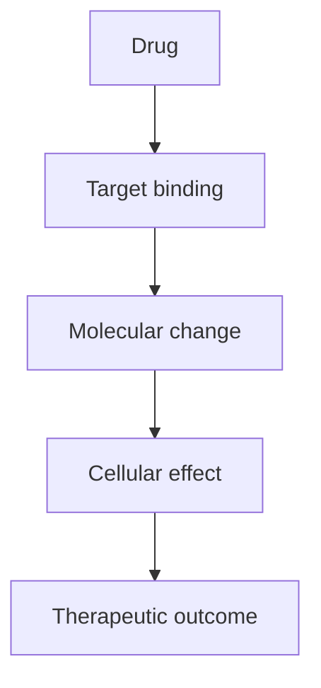

# [Generic name]

## A. Basic information
- Generic name:
- Brand names (verified only):
- Pharmacological class / subclass:
- Therapeutic category:
- Chemical characteristics (if relevant):

## B. Classification
- Main class:
- Subclass:
- Related drugs:

## C. Mechanism of action
- Primary molecular target:
- Stepwise mechanism:
- Cellular, physiological and therapeutic effects:

## D. Pharmacokinetics
Absorption | Distribution | Metabolism | Excretion | Half-life | Bioavailability

## E. Therapeutic uses
- Approved indications (state jurisdiction):
- Off-label uses (clearly labelled):

## F. Adverse drug reactions
- Common:
- Serious:
- Organ-specific toxicity:
- Contraindications and precautions:
- Monitoring:

## G. Drug interactions
| Interacting drug | Type (PK/PD) | Mechanism | Clinical consequence | Severity | Source |
|---|---|---|---|---|---|

## H. Clinical pearls
-

## I. References
1.
