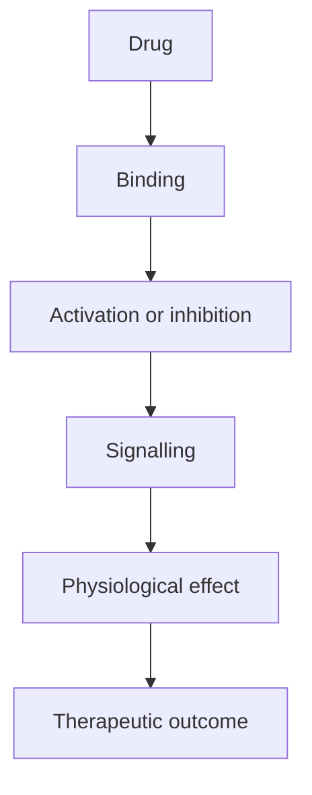

# [Mechanism name]

- Target:
- Normal function of the target:
- How the drug interacts with it:
- Molecular changes:
- Downstream cellular effects:
- Physiological response:
- Therapeutic significance:
- Representative drugs:

## References
1.
